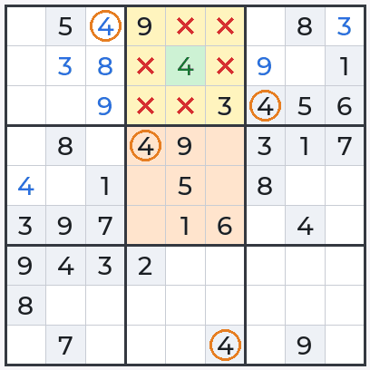

<!-- Written by tools/walkthrough.py magic-square: edit the script, not this page. -->
# Magic Square, step 8: the 4 in box 2

**Step 8 of 50** · [← Step 7](step-07.md) · [All steps](../magic-square.md#the-whole-puzzle-step-by-step) · [Step 9 →](step-09.md)

Box 2 needs a 4. r1c5 and r1c6: row 1 has one (r1c3). r2c4: column 4 has one (r4c4). r2c6: column 6 has one (r9c6). r3c4 and r3c5: row 3 has one (r3c7). Only **r2c5** is left: **r2c5 = 4**.

**Step 8 of 50** · [← Step 7](step-07.md) · [All steps](../magic-square.md#the-whole-puzzle-step-by-step) · [Step 9 →](step-09.md)
