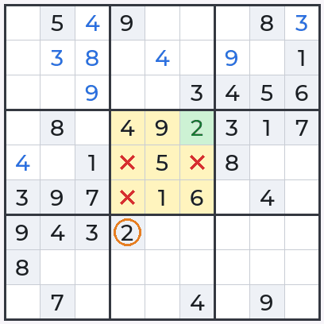

<!-- Written by tools/walkthrough.py magic-square: edit the script, not this page. -->
# Magic Square, step 9: the 2 in box 5

**Step 9 of 50** · [← Step 8](step-08.md) · [All steps](../magic-square.md#the-whole-puzzle-step-by-step) · [Step 10 →](step-10.md)

Box 5 needs a 2. r5c4 and r6c4: column 4 has one (r7c4). r5c6: the chains of signs in its box keep it between 1 and 9. Only **r4c6** is left: **r4c6 = 2**.

**Step 9 of 50** · [← Step 8](step-08.md) · [All steps](../magic-square.md#the-whole-puzzle-step-by-step) · [Step 10 →](step-10.md)
