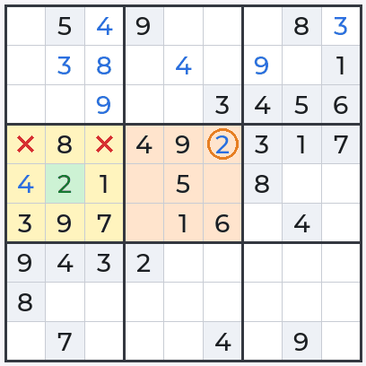

<!-- Written by tools/walkthrough.py magic-square: edit the script, not this page. -->
# Magic Square, step 10: the 2 in box 4

**Step 10 of 50** · [← Step 9](step-09.md) · [All steps](../magic-square.md#the-whole-puzzle-step-by-step) · [Step 11 →](step-11.md)

Box 4 needs a 2. r4c1 and r4c3: row 4 has one (r4c6). Only **r5c2** is left: **r5c2 = 2**.

**Step 10 of 50** · [← Step 9](step-09.md) · [All steps](../magic-square.md#the-whole-puzzle-step-by-step) · [Step 11 →](step-11.md)
