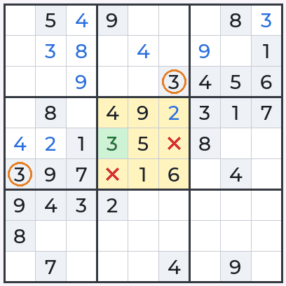

<!-- Written by tools/walkthrough.py magic-square: edit the script, not this page. -->
# Magic Square, step 11: the 3 in box 5

**Step 11 of 50** · [← Step 10](step-10.md) · [All steps](../magic-square.md#the-whole-puzzle-step-by-step) · [Step 12 →](step-12.md)

Box 5 needs a 3. r5c6: column 6 has one (r3c6). r6c4: row 6 has one (r6c1). Only **r5c4** is left: **r5c4 = 3**.

**Step 11 of 50** · [← Step 10](step-10.md) · [All steps](../magic-square.md#the-whole-puzzle-step-by-step) · [Step 12 →](step-12.md)
