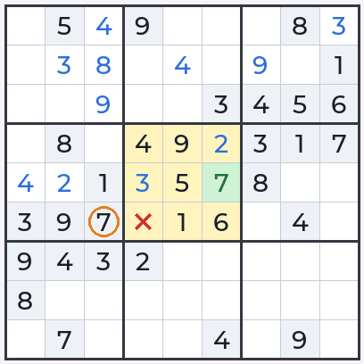

<!-- Written by tools/walkthrough.py magic-square: edit the script, not this page. -->
# Magic Square, step 12: the 7 in box 5

**Step 12 of 50** · [← Step 11](step-11.md) · [All steps](../magic-square.md#the-whole-puzzle-step-by-step) · [Step 13 →](step-13.md)

Box 5 needs a 7. r6c4: row 6 has one (r6c3). Only **r5c6** is left: **r5c6 = 7**.

**Step 12 of 50** · [← Step 11](step-11.md) · [All steps](../magic-square.md#the-whole-puzzle-step-by-step) · [Step 13 →](step-13.md)
