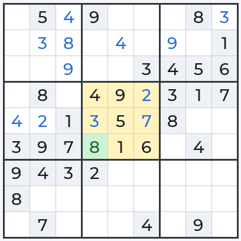

<!-- Written by tools/walkthrough.py magic-square: edit the script, not this page. -->
# Magic Square, step 13: the 8 in box 5

**Step 13 of 50** · [← Step 12](step-12.md) · [All steps](../magic-square.md#the-whole-puzzle-step-by-step) · [Step 14 →](step-14.md)

Box 5 needs an 8, and r6c4 is its last empty cell: **r6c4 = 8**.

**Step 13 of 50** · [← Step 12](step-12.md) · [All steps](../magic-square.md#the-whole-puzzle-step-by-step) · [Step 14 →](step-14.md)
