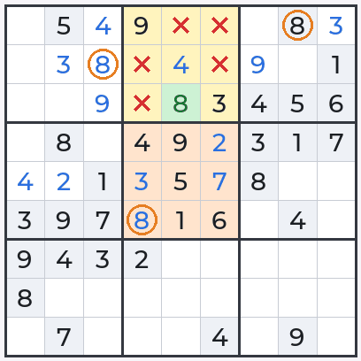

<!-- Written by tools/walkthrough.py magic-square: edit the script, not this page. -->
# Magic Square, step 14: the 8 in box 2

**Step 14 of 50** · [← Step 13](step-13.md) · [All steps](../magic-square.md#the-whole-puzzle-step-by-step) · [Step 15 →](step-15.md)

Box 2 needs an 8. r1c5 and r1c6: row 1 has one (r1c8). r2c4 and r2c6: row 2 has one (r2c3). r3c4: column 4 has one (r6c4). Only **r3c5** is left: **r3c5 = 8**.

**Step 14 of 50** · [← Step 13](step-13.md) · [All steps](../magic-square.md#the-whole-puzzle-step-by-step) · [Step 15 →](step-15.md)
