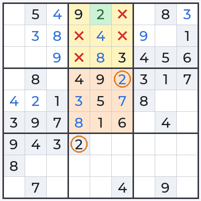

<!-- Written by tools/walkthrough.py magic-square: edit the script, not this page. -->
# Magic Square, step 15: the 2 in box 2

**Step 15 of 50** · [← Step 14](step-14.md) · [All steps](../magic-square.md#the-whole-puzzle-step-by-step) · [Step 16 →](step-16.md)

Box 2 needs a 2. r1c6 and r2c6: column 6 has one (r4c6). r2c4 and r3c4: column 4 has one (r7c4). Only **r1c5** is left: **r1c5 = 2**.

**Step 15 of 50** · [← Step 14](step-14.md) · [All steps](../magic-square.md#the-whole-puzzle-step-by-step) · [Step 16 →](step-16.md)
