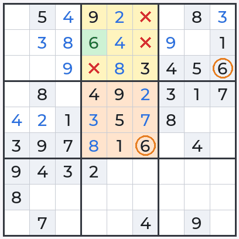

<!-- Written by tools/walkthrough.py magic-square: edit the script, not this page. -->
# Magic Square, step 16: the 6 in box 2

**Step 16 of 50** · [← Step 15](step-15.md) · [All steps](../magic-square.md#the-whole-puzzle-step-by-step) · [Step 17 →](step-17.md)

Box 2 needs a 6. r1c6 and r2c6: column 6 has one (r6c6). r3c4: row 3 has one (r3c9). Only **r2c4** is left: **r2c4 = 6**.

**Step 16 of 50** · [← Step 15](step-15.md) · [All steps](../magic-square.md#the-whole-puzzle-step-by-step) · [Step 17 →](step-17.md)
