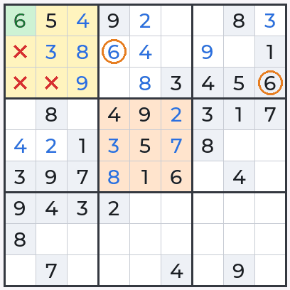

<!-- Written by tools/walkthrough.py magic-square: edit the script, not this page. -->
# Magic Square, step 17: the 6 in box 1

**Step 17 of 50** · [← Step 16](step-16.md) · [All steps](../magic-square.md#the-whole-puzzle-step-by-step) · [Step 18 →](step-18.md)

Box 1 needs a 6. r2c1: row 2 has one (r2c4). r3c1 and r3c2: row 3 has one (r3c9). Only **r1c1** is left: **r1c1 = 6**.

**Step 17 of 50** · [← Step 16](step-16.md) · [All steps](../magic-square.md#the-whole-puzzle-step-by-step) · [Step 18 →](step-18.md)
