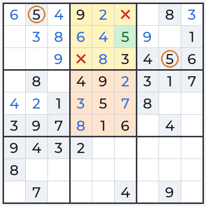

<!-- Written by tools/walkthrough.py magic-square: edit the script, not this page. -->
# Magic Square, step 18: the 5 in box 2

**Step 18 of 50** · [← Step 17](step-17.md) · [All steps](../magic-square.md#the-whole-puzzle-step-by-step) · [Step 19 →](step-19.md)

Box 2 needs a 5. r1c6: row 1 has one (r1c2). r3c4: row 3 has one (r3c8). Only **r2c6** is left: **r2c6 = 5**.

**Step 18 of 50** · [← Step 17](step-17.md) · [All steps](../magic-square.md#the-whole-puzzle-step-by-step) · [Step 19 →](step-19.md)
