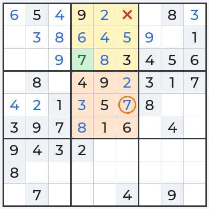

<!-- Written by tools/walkthrough.py magic-square: edit the script, not this page. -->
# Magic Square, step 19: the 7 in box 2

**Step 19 of 50** · [← Step 18](step-18.md) · [All steps](../magic-square.md#the-whole-puzzle-step-by-step) · [Step 20 →](step-20.md)

Box 2 needs a 7. r1c6: column 6 has one (r5c6). Only **r3c4** is left: **r3c4 = 7**.

**Step 19 of 50** · [← Step 18](step-18.md) · [All steps](../magic-square.md#the-whole-puzzle-step-by-step) · [Step 20 →](step-20.md)
