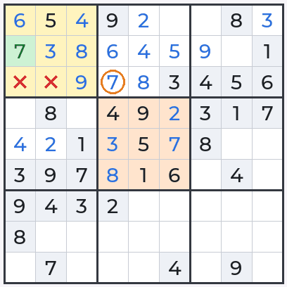

<!-- Written by tools/walkthrough.py magic-square: edit the script, not this page. -->
# Magic Square, step 20: the 7 in box 1

**Step 20 of 50** · [← Step 19](step-19.md) · [All steps](../magic-square.md#the-whole-puzzle-step-by-step) · [Step 21 →](step-21.md)

Box 1 needs a 7. r3c1 and r3c2: row 3 has one (r3c4). Only **r2c1** is left: **r2c1 = 7**.

**Step 20 of 50** · [← Step 19](step-19.md) · [All steps](../magic-square.md#the-whole-puzzle-step-by-step) · [Step 21 →](step-21.md)
