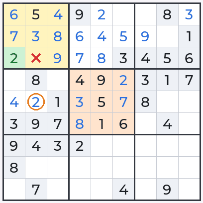

<!-- Written by tools/walkthrough.py magic-square: edit the script, not this page. -->
# Magic Square, step 21: the 2 in box 1

**Step 21 of 50** · [← Step 20](step-20.md) · [All steps](../magic-square.md#the-whole-puzzle-step-by-step) · [Step 22 →](step-22.md)

Box 1 needs a 2. r3c2: column 2 has one (r5c2). Only **r3c1** is left: **r3c1 = 2**.

**Step 21 of 50** · [← Step 20](step-20.md) · [All steps](../magic-square.md#the-whole-puzzle-step-by-step) · [Step 22 →](step-22.md)
