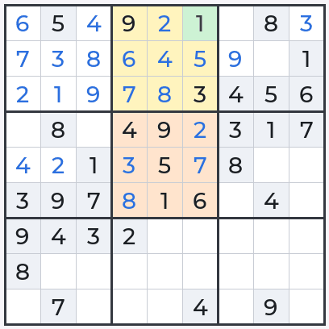

<!-- Written by tools/walkthrough.py magic-square: edit the script, not this page. -->
# Magic Square, step 23: the 1 in box 2

**Step 23 of 50** · [← Step 22](step-22.md) · [All steps](../magic-square.md#the-whole-puzzle-step-by-step) · [Step 24 →](step-24.md)

Box 2 needs a 1, and r1c6 is its last empty cell: **r1c6 = 1**.

**Step 23 of 50** · [← Step 22](step-22.md) · [All steps](../magic-square.md#the-whole-puzzle-step-by-step) · [Step 24 →](step-24.md)
