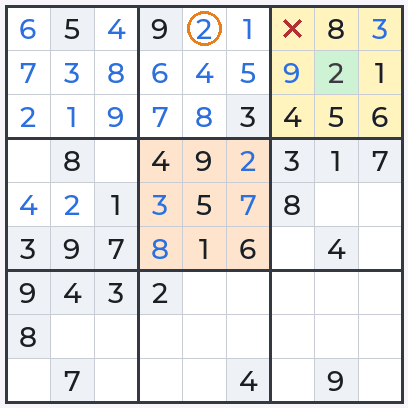

<!-- Written by tools/walkthrough.py magic-square: edit the script, not this page. -->
# Magic Square, step 24: the 2 in box 3

**Step 24 of 50** · [← Step 23](step-23.md) · [All steps](../magic-square.md#the-whole-puzzle-step-by-step) · [Step 25 →](step-25.md)

Box 3 needs a 2. r1c7: row 1 has one (r1c5). Only **r2c8** is left: **r2c8 = 2**.

**Step 24 of 50** · [← Step 23](step-23.md) · [All steps](../magic-square.md#the-whole-puzzle-step-by-step) · [Step 25 →](step-25.md)
