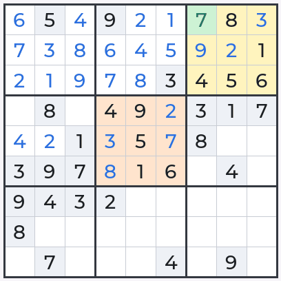

<!-- Written by tools/walkthrough.py magic-square: edit the script, not this page. -->
# Magic Square, step 25: the 7 in box 3

**Step 25 of 50** · [← Step 24](step-24.md) · [All steps](../magic-square.md#the-whole-puzzle-step-by-step) · [Step 26 →](step-26.md)

Box 3 needs a 7, and r1c7 is its last empty cell: **r1c7 = 7**.

**Step 25 of 50** · [← Step 24](step-24.md) · [All steps](../magic-square.md#the-whole-puzzle-step-by-step) · [Step 26 →](step-26.md)
