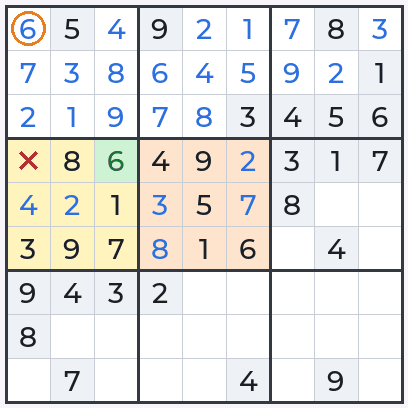

<!-- Written by tools/walkthrough.py magic-square: edit the script, not this page. -->
# Magic Square, step 26: the 6 in box 4

**Step 26 of 50** · [← Step 25](step-25.md) · [All steps](../magic-square.md#the-whole-puzzle-step-by-step) · [Step 27 →](step-27.md)

Box 4 needs a 6. r4c1: column 1 has one (r1c1). Only **r4c3** is left: **r4c3 = 6**.

**Step 26 of 50** · [← Step 25](step-25.md) · [All steps](../magic-square.md#the-whole-puzzle-step-by-step) · [Step 27 →](step-27.md)
