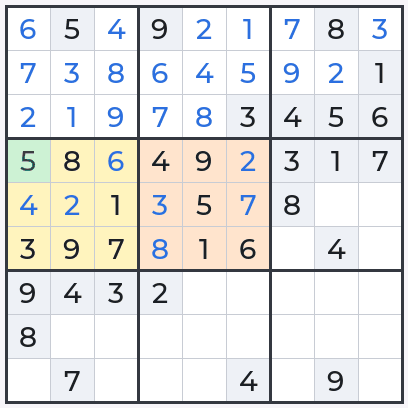

<!-- Written by tools/walkthrough.py magic-square: edit the script, not this page. -->
# Magic Square, step 27: the 5 in box 4

**Step 27 of 50** · [← Step 26](step-26.md) · [All steps](../magic-square.md#the-whole-puzzle-step-by-step) · [Step 28 →](step-28.md)

Box 4 needs a 5, and r4c1 is its last empty cell: **r4c1 = 5**.

**Step 27 of 50** · [← Step 26](step-26.md) · [All steps](../magic-square.md#the-whole-puzzle-step-by-step) · [Step 28 →](step-28.md)
