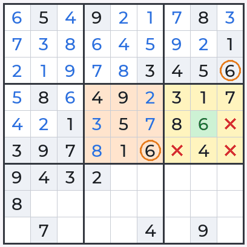

<!-- Written by tools/walkthrough.py magic-square: edit the script, not this page. -->
# Magic Square, step 28: the 6 in box 6

**Step 28 of 50** · [← Step 27](step-27.md) · [All steps](../magic-square.md#the-whole-puzzle-step-by-step) · [Step 29 →](step-29.md)

Box 6 needs a 6. r5c9: column 9 has one (r3c9). r6c7 and r6c9: row 6 has one (r6c6). Only **r5c8** is left: **r5c8 = 6**.

**Step 28 of 50** · [← Step 27](step-27.md) · [All steps](../magic-square.md#the-whole-puzzle-step-by-step) · [Step 29 →](step-29.md)
