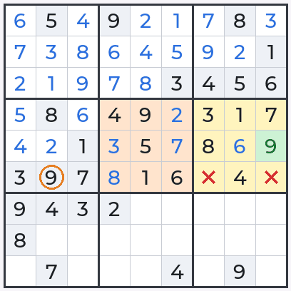

<!-- Written by tools/walkthrough.py magic-square: edit the script, not this page. -->
# Magic Square, step 29: the 9 in box 6

**Step 29 of 50** · [← Step 28](step-28.md) · [All steps](../magic-square.md#the-whole-puzzle-step-by-step) · [Step 30 →](step-30.md)

Box 6 needs a 9. r6c7 and r6c9: row 6 has one (r6c2). Only **r5c9** is left: **r5c9 = 9**.

**Step 29 of 50** · [← Step 28](step-28.md) · [All steps](../magic-square.md#the-whole-puzzle-step-by-step) · [Step 30 →](step-30.md)
