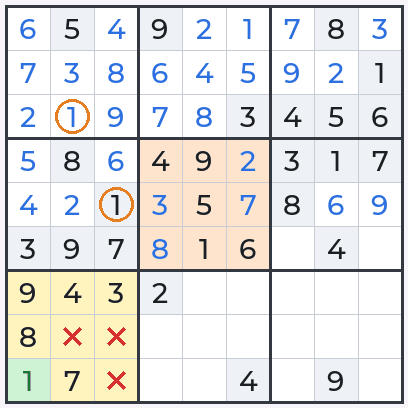

<!-- Written by tools/walkthrough.py magic-square: edit the script, not this page. -->
# Magic Square, step 30: the 1 in box 7

**Step 30 of 50** · [← Step 29](step-29.md) · [All steps](../magic-square.md#the-whole-puzzle-step-by-step) · [Step 31 →](step-31.md)

Box 7 needs a 1. r8c2: column 2 has one (r3c2). r8c3 and r9c3: column 3 has one (r5c3). Only **r9c1** is left: **r9c1 = 1**.

**Step 30 of 50** · [← Step 29](step-29.md) · [All steps](../magic-square.md#the-whole-puzzle-step-by-step) · [Step 31 →](step-31.md)
