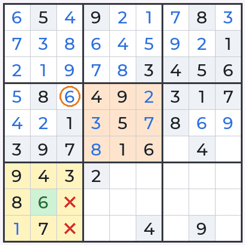

<!-- Written by tools/walkthrough.py magic-square: edit the script, not this page. -->
# Magic Square, step 31: the 6 in box 7

**Step 31 of 50** · [← Step 30](step-30.md) · [All steps](../magic-square.md#the-whole-puzzle-step-by-step) · [Step 32 →](step-32.md)

Box 7 needs a 6. r8c3 and r9c3: column 3 has one (r4c3). Only **r8c2** is left: **r8c2 = 6**.

**Step 31 of 50** · [← Step 30](step-30.md) · [All steps](../magic-square.md#the-whole-puzzle-step-by-step) · [Step 32 →](step-32.md)
