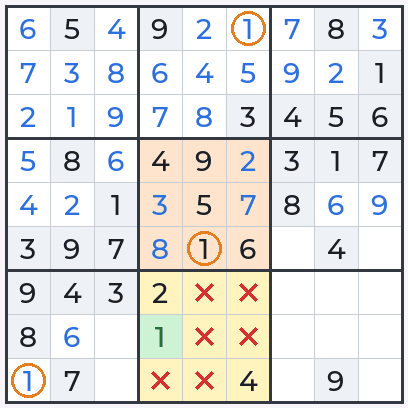

<!-- Written by tools/walkthrough.py magic-square: edit the script, not this page. -->
# Magic Square, step 32: the 1 in box 8

**Step 32 of 50** · [← Step 31](step-31.md) · [All steps](../magic-square.md#the-whole-puzzle-step-by-step) · [Step 33 →](step-33.md)

Box 8 needs a 1. r7c5 and r8c5: column 5 has one (r6c5). r7c6 and r8c6: column 6 has one (r1c6). r9c4 and r9c5: row 9 has one (r9c1). Only **r8c4** is left: **r8c4 = 1**.

**Step 32 of 50** · [← Step 31](step-31.md) · [All steps](../magic-square.md#the-whole-puzzle-step-by-step) · [Step 33 →](step-33.md)
