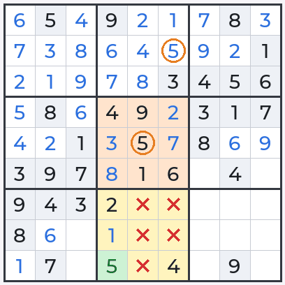

<!-- Written by tools/walkthrough.py magic-square: edit the script, not this page. -->
# Magic Square, step 33: the 5 in box 8

**Step 33 of 50** · [← Step 32](step-32.md) · [All steps](../magic-square.md#the-whole-puzzle-step-by-step) · [Step 34 →](step-34.md)

Box 8 needs a 5. r7c5, r8c5 and r9c5: column 5 has one (r5c5). r7c6 and r8c6: column 6 has one (r2c6). Only **r9c4** is left: **r9c4 = 5**.

**Step 33 of 50** · [← Step 32](step-32.md) · [All steps](../magic-square.md#the-whole-puzzle-step-by-step) · [Step 34 →](step-34.md)
