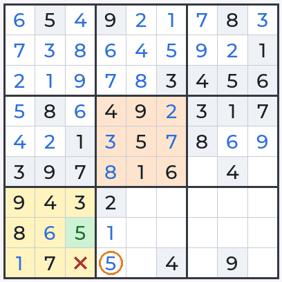

<!-- Written by tools/walkthrough.py magic-square: edit the script, not this page. -->
# Magic Square, step 34: the 5 in box 7

**Step 34 of 50** · [← Step 33](step-33.md) · [All steps](../magic-square.md#the-whole-puzzle-step-by-step) · [Step 35 →](step-35.md)

Box 7 needs a 5. r9c3: row 9 has one (r9c4). Only **r8c3** is left: **r8c3 = 5**.

**Step 34 of 50** · [← Step 33](step-33.md) · [All steps](../magic-square.md#the-whole-puzzle-step-by-step) · [Step 35 →](step-35.md)
