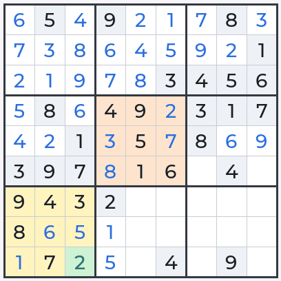

<!-- Written by tools/walkthrough.py magic-square: edit the script, not this page. -->
# Magic Square, step 35: the 2 in box 7

**Step 35 of 50** · [← Step 34](step-34.md) · [All steps](../magic-square.md#the-whole-puzzle-step-by-step) · [Step 36 →](step-36.md)

Box 7 needs a 2, and r9c3 is its last empty cell: **r9c3 = 2**.

**Step 35 of 50** · [← Step 34](step-34.md) · [All steps](../magic-square.md#the-whole-puzzle-step-by-step) · [Step 36 →](step-36.md)
