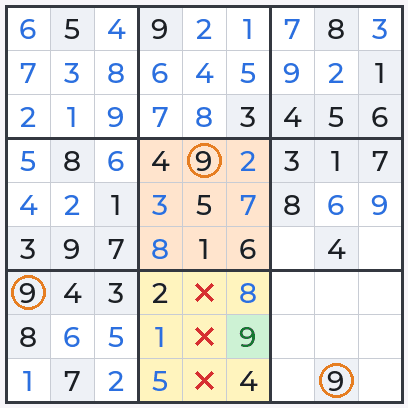

<!-- Written by tools/walkthrough.py magic-square: edit the script, not this page. -->
# Magic Square, step 37: the 9 in box 8

**Step 37 of 50** · [← Step 36](step-36.md) · [All steps](../magic-square.md#the-whole-puzzle-step-by-step) · [Step 38 →](step-38.md)

Box 8 needs a 9. r7c5: row 7 has one (r7c1). r8c5: column 5 has one (r4c5). r9c5: row 9 has one (r9c8). Only **r8c6** is left: **r8c6 = 9**.

**Step 37 of 50** · [← Step 36](step-36.md) · [All steps](../magic-square.md#the-whole-puzzle-step-by-step) · [Step 38 →](step-38.md)
