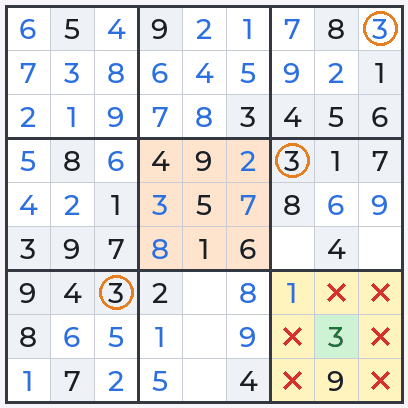

<!-- Written by tools/walkthrough.py magic-square: edit the script, not this page. -->
# Magic Square, step 39: the 3 in box 9

**Step 39 of 50** · [← Step 38](step-38.md) · [All steps](../magic-square.md#the-whole-puzzle-step-by-step) · [Step 40 →](step-40.md)

Box 9 needs a 3. r7c8 and r7c9: row 7 has one (r7c3). r8c7 and r9c7: column 7 has one (r4c7). r8c9 and r9c9: column 9 has one (r1c9). Only **r8c8** is left: **r8c8 = 3**.

**Step 39 of 50** · [← Step 38](step-38.md) · [All steps](../magic-square.md#the-whole-puzzle-step-by-step) · [Step 40 →](step-40.md)
