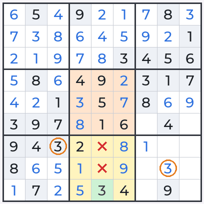

<!-- Written by tools/walkthrough.py magic-square: edit the script, not this page. -->
# Magic Square, step 40: the 3 in box 8

**Step 40 of 50** · [← Step 39](step-39.md) · [All steps](../magic-square.md#the-whole-puzzle-step-by-step) · [Step 41 →](step-41.md)

Box 8 needs a 3. r7c5: row 7 has one (r7c3). r8c5: row 8 has one (r8c8). Only **r9c5** is left: **r9c5 = 3**.

**Step 40 of 50** · [← Step 39](step-39.md) · [All steps](../magic-square.md#the-whole-puzzle-step-by-step) · [Step 41 →](step-41.md)
