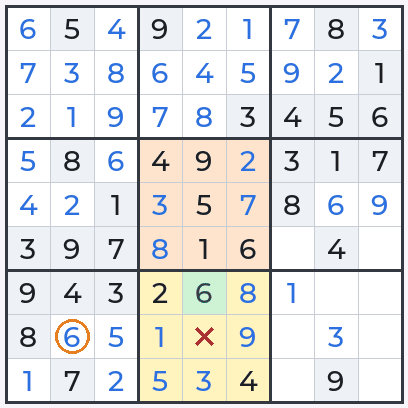

<!-- Written by tools/walkthrough.py magic-square: edit the script, not this page. -->
# Magic Square, step 41: the 6 in box 8

**Step 41 of 50** · [← Step 40](step-40.md) · [All steps](../magic-square.md#the-whole-puzzle-step-by-step) · [Step 42 →](step-42.md)

Box 8 needs a 6. r8c5: row 8 has one (r8c2). Only **r7c5** is left: **r7c5 = 6**.

**Step 41 of 50** · [← Step 40](step-40.md) · [All steps](../magic-square.md#the-whole-puzzle-step-by-step) · [Step 42 →](step-42.md)
