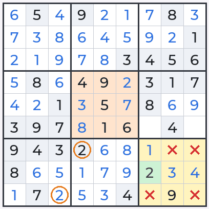

<!-- Written by tools/walkthrough.py magic-square: edit the script, not this page. -->
# Magic Square, step 44: the 2 in box 9

**Step 44 of 50** · [← Step 43](step-43.md) · [All steps](../magic-square.md#the-whole-puzzle-step-by-step) · [Step 45 →](step-45.md)

Box 9 needs a 2. r7c8 and r7c9: row 7 has one (r7c4). r9c7 and r9c9: row 9 has one (r9c3). Only **r8c7** is left: **r8c7 = 2**.

**Step 44 of 50** · [← Step 43](step-43.md) · [All steps](../magic-square.md#the-whole-puzzle-step-by-step) · [Step 45 →](step-45.md)
