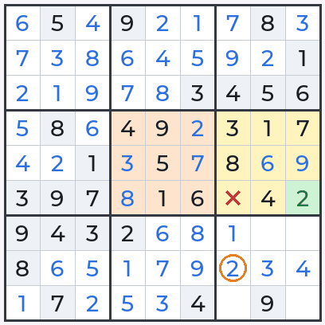

<!-- Written by tools/walkthrough.py magic-square: edit the script, not this page. -->
# Magic Square, step 45: the 2 in box 6

**Step 45 of 50** · [← Step 44](step-44.md) · [All steps](../magic-square.md#the-whole-puzzle-step-by-step) · [Step 46 →](step-46.md)

Box 6 needs a 2. r6c7: column 7 has one (r8c7). Only **r6c9** is left: **r6c9 = 2**.

**Step 45 of 50** · [← Step 44](step-44.md) · [All steps](../magic-square.md#the-whole-puzzle-step-by-step) · [Step 46 →](step-46.md)
