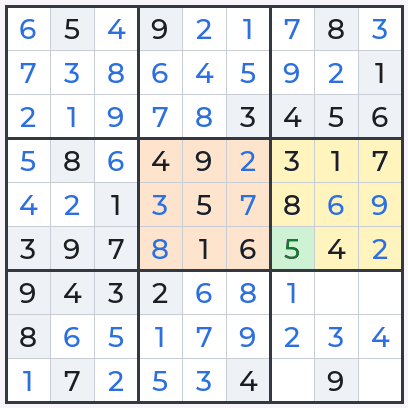

<!-- Written by tools/walkthrough.py magic-square: edit the script, not this page. -->
# Magic Square, step 46: the 5 in box 6

**Step 46 of 50** · [← Step 45](step-45.md) · [All steps](../magic-square.md#the-whole-puzzle-step-by-step) · [Step 47 →](step-47.md)

Box 6 needs a 5, and r6c7 is its last empty cell: **r6c7 = 5**.

**Step 46 of 50** · [← Step 45](step-45.md) · [All steps](../magic-square.md#the-whole-puzzle-step-by-step) · [Step 47 →](step-47.md)
