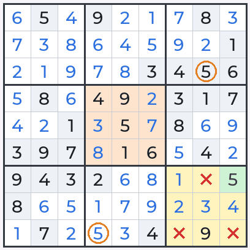

<!-- Written by tools/walkthrough.py magic-square: edit the script, not this page. -->
# Magic Square, step 47: the 5 in box 9

**Step 47 of 50** · [← Step 46](step-46.md) · [All steps](../magic-square.md#the-whole-puzzle-step-by-step) · [Step 48 →](step-48.md)

Box 9 needs a 5. r7c8: column 8 has one (r3c8). r9c7 and r9c9: row 9 has one (r9c4). Only **r7c9** is left: **r7c9 = 5**.

**Step 47 of 50** · [← Step 46](step-46.md) · [All steps](../magic-square.md#the-whole-puzzle-step-by-step) · [Step 48 →](step-48.md)
