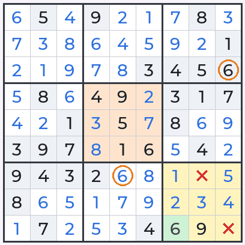

<!-- Written by tools/walkthrough.py magic-square: edit the script, not this page. -->
# Magic Square, step 48: the 6 in box 9

**Step 48 of 50** · [← Step 47](step-47.md) · [All steps](../magic-square.md#the-whole-puzzle-step-by-step) · [Step 49 →](step-49.md)

Box 9 needs a 6. r7c8: row 7 has one (r7c5). r9c9: column 9 has one (r3c9). Only **r9c7** is left: **r9c7 = 6**.

**Step 48 of 50** · [← Step 47](step-47.md) · [All steps](../magic-square.md#the-whole-puzzle-step-by-step) · [Step 49 →](step-49.md)
