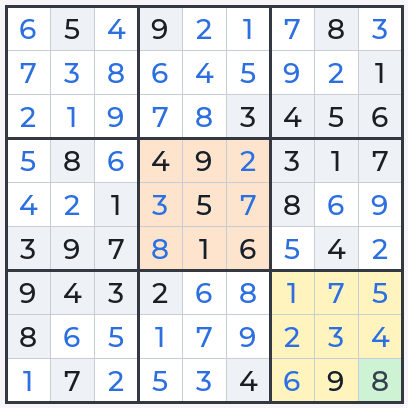

<!-- Written by tools/walkthrough.py magic-square: edit the script, not this page. -->
# Magic Square, step 50: the 8 in box 9

**Step 50 of 50** · [← Step 49](step-49.md) · [All steps](../magic-square.md#the-whole-puzzle-step-by-step) · [All steps](../magic-square.md#the-whole-puzzle-step-by-step)

Box 9 needs an 8, and r9c9 is its last empty cell: **r9c9 = 8**.

Solved.

**Step 50 of 50** · [← Step 49](step-49.md) · [All steps](../magic-square.md#the-whole-puzzle-step-by-step) · [All steps](../magic-square.md#the-whole-puzzle-step-by-step)
