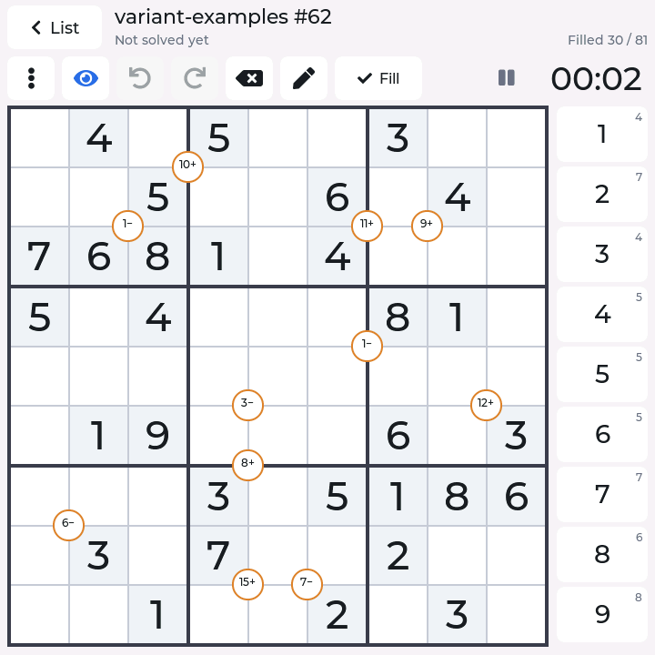
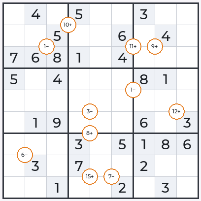

# Mathrax

[← All variants](README.md) · [Puzzles](../features-puzzles.md) · [How to play](../how-to-play.md)

## The rules

[Classic](classic.md) rules, and **circles** where four cells meet, each with a clue that **both diagonal pairs** of those cells make: the top-left cell with the bottom-right one, and the top-right with the bottom-left.

- **9+**: each pair adds up to 9;
- **2−**: the two digits of each pair are 2 apart;
- **12×**: each pair multiplies to 12;
- **3÷**: in each pair, one digit is 3 times the other;
- **E**: all four cells are even; **O**: all four are odd.

Only the diagonal pairs count: two cells side by side at a circle can be anything the other rules allow.

## On the board

- Each circle sits on the corner where its four cells meet, its clue inside, ringed in orange like Quadruple's.
- A digit that breaks a circle turns red: a full diagonal pair that doesn't make the clue, or a digit no partner could make it with (a 9 at a 9+ circle, an odd digit at an E one).
- The grader and hints know one step: a circle's cell keeps only the digits that some candidate of the cell across the circle makes the clue with. "The 9+ circle: both diagonal pairs of its four cells add up to 9. What the cell across from row 3, column 7 can be leaves it only 5."
- **Puzzles → ⋮ → New puzzle → Marks → Mathrax**: 11 circles (Hard and Expert 14), each where some clue holds. The harder levels give few digits: the circles do the work.

## How to solve it

- **What a circle allows at all:** a 9+ circle never holds a 9 (its partner would be 0); 12× allows only 2, 3, 4 and 6 (2 × 6, 3 × 4); 3÷ only 1, 2, 3, 6 and 9; 8− only 1 and 9; E only 2, 4, 6 and 8.
- **Across the circle:** once one cell of a pair is known, the other is fixed for + and ×, and has at most two choices for − and ÷.
- **A circle inside a box:** its four cells then hold four different digits, which rules out pairs that would repeat one (for 10+, 5 and 5).
- **A cell at two circles** has to suit both: often that leaves one digit.

## Worked example

**variant-examples #62**, Mathrax Easy (see [Classic](classic.md#worked-example-the-whole-puzzle) for how to import the examples; cells are written r*row*c*column*). The circles are in the screenshot; three matter here:

- **1−** where r2c2, r2c3, r3c2 and r3c3 meet (r2c3 is 5, r3c2 is 6, r3c3 is 8);
- **9+** where r2c7, r2c8, r3c7 and r3c8 meet (r2c8 is 4);
- **11+** where r2c6, r2c7, r3c6 and r3c7 meet (r2c6 is 6, r3c6 is 4).

**Step 1: r2c2, at the 1− circle.** Row 2 has 5, 6 and 4; column 2 has 4, 6, 1 and 3; box 1 has 4, 5, 7, 6 and 8. By the Classic rules r2c2 could be 2 or 9. Across the circle from it is the 8 in r3c3, and 2 is 6 away from 8, not 1. **r2c2 = 9**.

**Step 2: r3c7, at two circles.** By the Classic rules r3c7 could be 5 or 9 (row 3 has 7, 6, 8, 1 and 4; column 7 has 3, 8, 6, 1 and 2). Across the 9+ circle from it is the 4 in r2c8: 9 + 4 isn't 9, 5 + 4 is. (Across the 11+ circle is the 6 in r2c6: 5 + 6 = 11 too.) **r3c7 = 5**.

**Step 3: r3c8, at the 9+ circle.** Row 3 now has 7, 6, 8, 1, 4 and 5, column 8 has 4, 1, 8 and 3: r3c8 could be 2 or 9. A 9 can't stand at a 9+ circle: its partner would have to be 0. **r3c8 = 2**, and across the circle, r2c7 will be 7.

## The whole puzzle, step by step

<!-- walkthrough -->
<!-- Written by tools/walkthrough.py mathrax: edit the script, not this part. -->

The whole puzzle, from the start to the last cell: 51 steps, each one a single (one place left for a digit, or one digit left for a cell), taken in the order a box's single comes first, so not quite the order of the worked example above. Each step has a page of its own, with **Previous** and **Next**: pick its number below. In each picture, the unit the step looks at is tinted yellow (for a cell with one digit left: its row, column and box), the new digit is on green, the digits that rule cells out have an **orange ring**, and the empty cells they rule out a **red cross**. Givens are on grey, digits from earlier steps in blue.

| [1](mathrax/step-01.md) | [2](mathrax/step-02.md) | [3](mathrax/step-03.md) | [4](mathrax/step-04.md) | [5](mathrax/step-05.md) | [6](mathrax/step-06.md) | [7](mathrax/step-07.md) | [8](mathrax/step-08.md) | [9](mathrax/step-09.md) | [10](mathrax/step-10.md) |
|:-:|:-:|:-:|:-:|:-:|:-:|:-:|:-:|:-:|:-:|
| [11](mathrax/step-11.md) | [12](mathrax/step-12.md) | [13](mathrax/step-13.md) | [14](mathrax/step-14.md) | [15](mathrax/step-15.md) | [16](mathrax/step-16.md) | [17](mathrax/step-17.md) | [18](mathrax/step-18.md) | [19](mathrax/step-19.md) | [20](mathrax/step-20.md) |
| [21](mathrax/step-21.md) | [22](mathrax/step-22.md) | [23](mathrax/step-23.md) | [24](mathrax/step-24.md) | [25](mathrax/step-25.md) | [26](mathrax/step-26.md) | [27](mathrax/step-27.md) | [28](mathrax/step-28.md) | [29](mathrax/step-29.md) | [30](mathrax/step-30.md) |
| [31](mathrax/step-31.md) | [32](mathrax/step-32.md) | [33](mathrax/step-33.md) | [34](mathrax/step-34.md) | [35](mathrax/step-35.md) | [36](mathrax/step-36.md) | [37](mathrax/step-37.md) | [38](mathrax/step-38.md) | [39](mathrax/step-39.md) | [40](mathrax/step-40.md) |
| [41](mathrax/step-41.md) | [42](mathrax/step-42.md) | [43](mathrax/step-43.md) | [44](mathrax/step-44.md) | [45](mathrax/step-45.md) | [46](mathrax/step-46.md) | [47](mathrax/step-47.md) | [48](mathrax/step-48.md) | [49](mathrax/step-49.md) | [50](mathrax/step-50.md) |
| [51](mathrax/step-51.md) |  |  |  |  |  |  |  |  |  |

Solved.

<!-- /walkthrough -->
