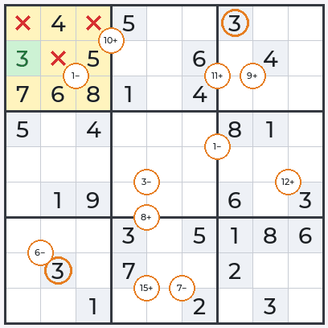

<!-- Written by tools/walkthrough.py mathrax: edit the script, not this page. -->
# Mathrax, step 1: the 3 in box 1

**Step 1 of 51** · [← The start](../mathrax.md#the-whole-puzzle-step-by-step) · [All steps](../mathrax.md#the-whole-puzzle-step-by-step) · [Step 2 →](step-02.md)

Box 1 needs a 3. r1c1 and r1c3: row 1 has one (r1c7). r2c2: column 2 has one (r8c2). Only **r2c1** is left: **r2c1 = 3**.

**Step 1 of 51** · [← The start](../mathrax.md#the-whole-puzzle-step-by-step) · [All steps](../mathrax.md#the-whole-puzzle-step-by-step) · [Step 2 →](step-02.md)
