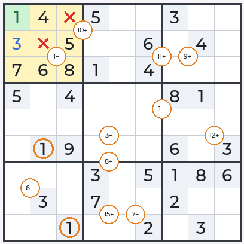

<!-- Written by tools/walkthrough.py mathrax: edit the script, not this page. -->
# Mathrax, step 2: the 1 in box 1

**Step 2 of 51** · [← Step 1](step-01.md) · [All steps](../mathrax.md#the-whole-puzzle-step-by-step) · [Step 3 →](step-03.md)

Box 1 needs a 1. r1c3: column 3 has one (r9c3). r2c2: column 2 has one (r6c2). Only **r1c1** is left: **r1c1 = 1**.

**Step 2 of 51** · [← Step 1](step-01.md) · [All steps](../mathrax.md#the-whole-puzzle-step-by-step) · [Step 3 →](step-03.md)
