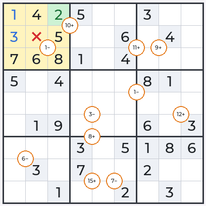

<!-- Written by tools/walkthrough.py mathrax: edit the script, not this page. -->
# Mathrax, step 3: the 2 in box 1

**Step 3 of 51** · [← Step 2](step-02.md) · [All steps](../mathrax.md#the-whole-puzzle-step-by-step) · [Step 4 →](step-04.md)

Box 1 needs a 2. r2c2: across the 1− circle from the 8 in r3c3: 2 and 8 aren't 1 apart. Only **r1c3** is left: **r1c3 = 2**.

**Step 3 of 51** · [← Step 2](step-02.md) · [All steps](../mathrax.md#the-whole-puzzle-step-by-step) · [Step 4 →](step-04.md)
