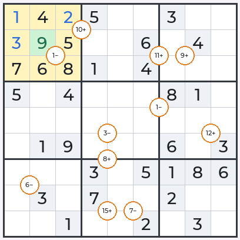

<!-- Written by tools/walkthrough.py mathrax: edit the script, not this page. -->
# Mathrax, step 4: the 9 in box 1

**Step 4 of 51** · [← Step 3](step-03.md) · [All steps](../mathrax.md#the-whole-puzzle-step-by-step) · [Step 5 →](step-05.md)

Box 1 needs a 9, and r2c2 is its last empty cell: **r2c2 = 9**.

**Step 4 of 51** · [← Step 3](step-03.md) · [All steps](../mathrax.md#the-whole-puzzle-step-by-step) · [Step 5 →](step-05.md)
