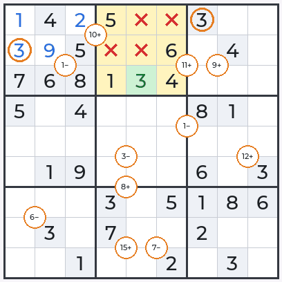

<!-- Written by tools/walkthrough.py mathrax: edit the script, not this page. -->
# Mathrax, step 5: the 3 in box 2

**Step 5 of 51** · [← Step 4](step-04.md) · [All steps](../mathrax.md#the-whole-puzzle-step-by-step) · [Step 6 →](step-06.md)

Box 2 needs a 3. r1c5 and r1c6: row 1 has one (r1c7). r2c4 and r2c5: row 2 has one (r2c1). Only **r3c5** is left: **r3c5 = 3**.

**Step 5 of 51** · [← Step 4](step-04.md) · [All steps](../mathrax.md#the-whole-puzzle-step-by-step) · [Step 6 →](step-06.md)
