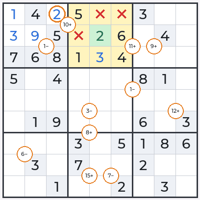

<!-- Written by tools/walkthrough.py mathrax: edit the script, not this page. -->
# Mathrax, step 6: the 2 in box 2

**Step 6 of 51** · [← Step 5](step-05.md) · [All steps](../mathrax.md#the-whole-puzzle-step-by-step) · [Step 7 →](step-07.md)

Box 2 needs a 2. r1c5 and r1c6: row 1 has one (r1c3). r2c4: across the 10+ circle from the 2 in r1c3: 2 and 2 don't add up to 10. Only **r2c5** is left: **r2c5 = 2**.

**Step 6 of 51** · [← Step 5](step-05.md) · [All steps](../mathrax.md#the-whole-puzzle-step-by-step) · [Step 7 →](step-07.md)
