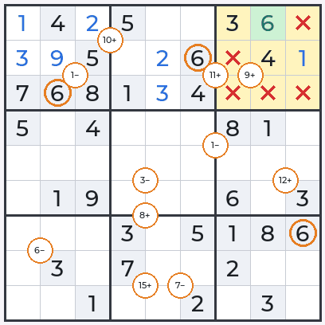

<!-- Written by tools/walkthrough.py mathrax: edit the script, not this page. -->
# Mathrax, step 8: the 6 in box 3

**Step 8 of 51** · [← Step 7](step-07.md) · [All steps](../mathrax.md#the-whole-puzzle-step-by-step) · [Step 9 →](step-09.md)

Box 3 needs a 6. r1c9: column 9 has one (r7c9). r2c7: row 2 has one (r2c6). r3c7, r3c8 and r3c9: row 3 has one (r3c2). Only **r1c8** is left: **r1c8 = 6**.

**Step 8 of 51** · [← Step 7](step-07.md) · [All steps](../mathrax.md#the-whole-puzzle-step-by-step) · [Step 9 →](step-09.md)
