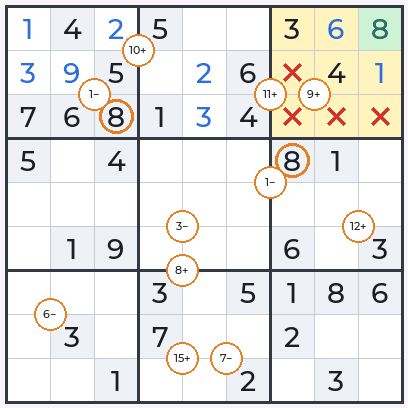

<!-- Written by tools/walkthrough.py mathrax: edit the script, not this page. -->
# Mathrax, step 9: the 8 in box 3

**Step 9 of 51** · [← Step 8](step-08.md) · [All steps](../mathrax.md#the-whole-puzzle-step-by-step) · [Step 10 →](step-10.md)

Box 3 needs an 8. r2c7: column 7 has one (r4c7). r3c7, r3c8 and r3c9: row 3 has one (r3c3). Only **r1c9** is left: **r1c9 = 8**.

**Step 9 of 51** · [← Step 8](step-08.md) · [All steps](../mathrax.md#the-whole-puzzle-step-by-step) · [Step 10 →](step-10.md)
