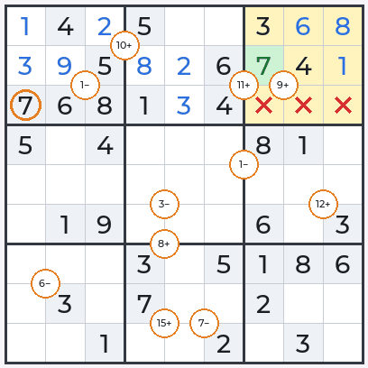

<!-- Written by tools/walkthrough.py mathrax: edit the script, not this page. -->
# Mathrax, step 11: the 7 in box 3

**Step 11 of 51** · [← Step 10](step-10.md) · [All steps](../mathrax.md#the-whole-puzzle-step-by-step) · [Step 12 →](step-12.md)

Box 3 needs a 7. r3c7, r3c8 and r3c9: row 3 has one (r3c1). Only **r2c7** is left: **r2c7 = 7**.

**Step 11 of 51** · [← Step 10](step-10.md) · [All steps](../mathrax.md#the-whole-puzzle-step-by-step) · [Step 12 →](step-12.md)
