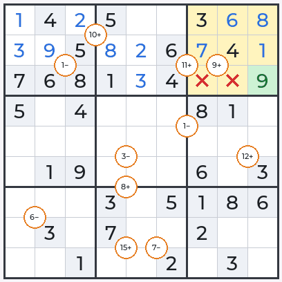

<!-- Written by tools/walkthrough.py mathrax: edit the script, not this page. -->
# Mathrax, step 12: the 9 in box 3

**Step 12 of 51** · [← Step 11](step-11.md) · [All steps](../mathrax.md#the-whole-puzzle-step-by-step) · [Step 13 →](step-13.md)

Box 3 needs a 9. r3c7: across the 9+ circle from the 4 in r2c8: 9 and 4 don't add up to 9. r3c8: across the 9+ circle from the 7 in r2c7: 9 and 7 don't add up to 9. Only **r3c9** is left: **r3c9 = 9**.

**Step 12 of 51** · [← Step 11](step-11.md) · [All steps](../mathrax.md#the-whole-puzzle-step-by-step) · [Step 13 →](step-13.md)
