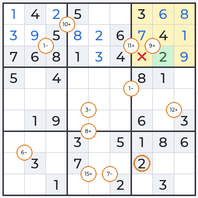

<!-- Written by tools/walkthrough.py mathrax: edit the script, not this page. -->
# Mathrax, step 13: the 2 in box 3

**Step 13 of 51** · [← Step 12](step-12.md) · [All steps](../mathrax.md#the-whole-puzzle-step-by-step) · [Step 14 →](step-14.md)

Box 3 needs a 2. r3c7: column 7 has one (r8c7). Only **r3c8** is left: **r3c8 = 2**.

**Step 13 of 51** · [← Step 12](step-12.md) · [All steps](../mathrax.md#the-whole-puzzle-step-by-step) · [Step 14 →](step-14.md)
