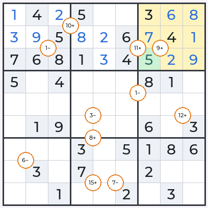

<!-- Written by tools/walkthrough.py mathrax: edit the script, not this page. -->
# Mathrax, step 14: the 5 in box 3

**Step 14 of 51** · [← Step 13](step-13.md) · [All steps](../mathrax.md#the-whole-puzzle-step-by-step) · [Step 15 →](step-15.md)

Box 3 needs a 5, and r3c7 is its last empty cell: **r3c7 = 5**.

**Step 14 of 51** · [← Step 13](step-13.md) · [All steps](../mathrax.md#the-whole-puzzle-step-by-step) · [Step 15 →](step-15.md)
